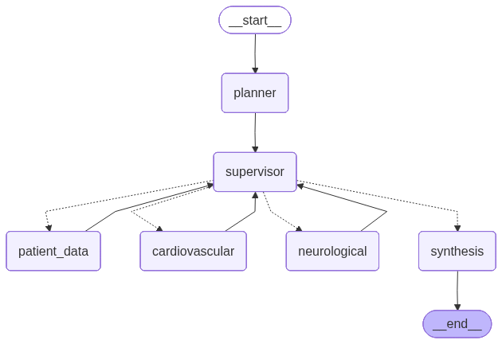

# DoctorAssistant


Doctor Assistant is a **Multi-Agent System (MAS)** built with **LangGraph/LangChain** that provides
AI-powered medical symptom analysis, preliminary diagnosis and nearby pharmacy search. It orchestrates multiple specialized agents working together.




## Table of Contents

- [Video Demo](#video-demo)
- [Project Structure](#project-structure)
- [Tech Stack](#tech-stack)
- [Getting Started](#getting-started)
  - [Prerequisites](#prerequisites)
  - [Configuration](#configuration)
  - [Option 1 — Local Setup](#option-1--local-setup)
  - [Option 2 — Docker](#option-2--docker)
- [License](#license)

---

## Video Demo

[Watch the demo video](https://drive.google.com/file/d/1xdEF-TDnVvLbRdakQA4jO5fB_Z5fvROG/view?usp=sharing)

## Project Structure

```
DoctorAssistant/
├── src/
│   └── doctor_assistant/       # Main package
│       ├── agents/             # Specialized agents (planner, supervisor, specialists)
│       ├── config/             # Configuration and settings
│       ├── knowledge_bases/    # RAG vector store loaders
│       ├── mcp/                # MCP client connections
│       ├── prompts/            # Agent prompt templates
│       ├── state/              # Graph state definitions
│       ├── tools/              # Agent tools
│       ├── utils/              # Helper utilities
│       ├── app.py              # Gradio web interface
│       └── graph.py            # LangGraph workflow
├── tests/
│   ├── unit/                   # Unit tests
│   └── integration/            # Integration tests
├── data/
│   ├── knowledge_bases/        # Medical PDF documents & FAISS vectorstores
│   └── samples/                # Sample patient data
├── docs/                       # Documentation
│   └── images/                 # Architecture diagrams
├── scripts/                    # Setup and utility scripts
├── Dockerfile                  # Multi-stage Docker build
├── docker-compose.yml          # Docker Compose service definition
├── .dockerignore               # Docker build context exclusions
├── .env.example                # Environment variables template
├── pyproject.toml              # Project configuration
├── requirements.txt            # Python dependencies
├── Makefile                    # Utility commands
└── README.md
```


<h2>Tech Stack</h2>

<table>
<tr>
<th>Category</th>
<th>Technologies</th>
<th>Purpose</th>
</tr>

<tr>
<td rowspan="4" align="center"><b>Core Stack</b></td>
<td>Python 3.12</td>
<td>Primary programming language</td>
</tr>
<tr>
<td>LangGraph</td>
<td>Multi-agent orchestration (StateGraph, conditional edges, checkpointing)</td>
</tr>
<tr>
<td>LangChain (Core, OpenAI, Community, HuggingFace)</td>
<td>LLM integration, prompts, tools, and RAG pipelines</td>
</tr>
<tr>
<td>Gradio</td>
<td>Chat-based web interface</td>
</tr>

<tr>
<td rowspan="3" align="center"><b>LLM Models</b></td>
<td>GPT-5.2</td>
<td>Used by most agents (Planner, Supervisor, Patient Data, Cardiovascular, Neurological, Pharmacy Finder)</td>
</tr>
<tr>
<td>GPT-4.1-nano</td>
<td>Used by the Synthesis agent</td>
</tr>
<tr>
<td>OpenAI-compatible proxy</td>
<td>Model access via custom endpoint</td>
</tr>

<tr>
<td rowspan="3" align="center"><b>RAG / Vector Search</b></td>
<td>FAISS</td>
<td>Vector similarity search over medical documents</td>
</tr>
<tr>
<td>HuggingFace Embeddings (all-MiniLM-L6-v2)</td>
<td>Local embedding generation</td>
</tr>
<tr>
<td>PyPDF</td>
<td>PDF loading and parsing</td>
</tr>

<tr>
<td rowspan="2" align="center"><b>MCP Integrations</b></td>
<td>Neon PostgreSQL MCP (Smithery)</td>
<td>Patient records database queries</td>
</tr>
<tr>
<td>Google Maps MCP (Smithery)</td>
<td>Pharmacy location search</td>
</tr>

<tr>
<td rowspan="3" align="center"><b>External APIs</b></td>
<td>Nominatim (OpenStreetMap)</td>
<td>Address geocoding</td>
</tr>
<tr>
<td>OSRM</td>
<td>Real-world routing and distance calculation</td>
</tr>
<tr>
<td>LangSmith</td>
<td>LLM tracing and observability</td>
</tr>

<tr>
<td rowspan="3" align="center"><b>Database</b></td>
<td>Neon PostgreSQL (Cloud)</td>
<td>Patient data storage</td>
</tr>
<tr>
<td>SQLAlchemy</td>
<td>ORM and database abstraction</td>
</tr>
<tr>
<td>psycopg2-binary / asyncpg</td>
<td>PostgreSQL drivers</td>
</tr>

<tr>
<td rowspan="2" align="center"><b>HTTP Clients</b></td>
<td>httpx</td>
<td>Async HTTP client for MCP communication</td>
</tr>
<tr>
<td>requests</td>
<td>External API calls</td>
</tr>

<tr>
<td rowspan="2" align="center"><b>Data Validation & Config</b></td>
<td>Pydantic</td>
<td>State schemas, structured LLM outputs, and tool validation</td>
</tr>
<tr>
<td>python-dotenv</td>
<td>Environment variable management</td>
</tr>

</table>

## Getting Started

### Prerequisites

- **Git** - [Download Git](https://git-scm.com/downloads)

### Configuration

Regardless of how you run the app, start by cloning the repository and configuring your environment variables.

1. **Clone the repository**
   ```bash
   git clone https://github.com/202422/DoctorAssistant.git
   cd DoctorAssistant
   ```

2. **Copy the example file**
   ```bash
   cp .env.example .env
   ```

3. **Edit `.env` and fill in your credentials:**

   | Variable | Description | Where to get it |
   |----------|-------------|-----------------|
   | `OPENAI_API_KEY` | OpenAI API key | [platform.openai.com](https://platform.openai.com/) |
   | `NEON_SMITHERY_API_KEY` | Smithery API key for Neon MCP | [smithery.ai](https://smithery.ai/) |
   | `MAP_SMITHERY_API_KEY` | Smithery API key for Google Maps MCP | [smithery.ai](https://smithery.ai/) |
   | `LANGSMITH_API_KEY` | LangSmith tracing (optional) | [smith.langchain.com](https://smith.langchain.com/) |
   | `NEON_DATABASE_URL` | PostgreSQL connection string | [neon.tech](https://neon.tech/) |

---

### Option 1 — Local Setup

**Additional prerequisites:** [Python 3.12+](https://www.python.org/downloads/)

1. **Create and activate a virtual environment**
   ```bash
   python -m venv .doctor_venv

   # Windows
   .doctor_venv\Scripts\activate

   # macOS / Linux
   source .doctor_venv/bin/activate
   ```

2. **Install the package**
   ```bash
   pip install -e .

   # With development dependencies (testing, linting)
   pip install -e ".[dev]"
   ```

3. **Start the application**
   ```bash
   # Using the CLI command
   doctor-assistant

   # Or via Python module
   python -m doctor_assistant.app
   ```

   The app will be available at **http://localhost:7860**

---

### Option 2 — Docker

**Additional prerequisites:** [Docker Desktop](https://www.docker.com/products/docker-desktop/) installed and running.

1. **Build and start the application**
   ```bash
   docker compose build
   docker compose up
   ```

   The app will be available at **http://localhost:7860**

   > On the first run, the HuggingFace embedding model (~90 MB) is downloaded automatically and cached — subsequent starts are instant.

2. **Stop the application**
   ```bash
   docker compose down
   ```

> **Note:** Your `.env` file stays on your machine and is never included in the image. Anyone running the project needs to supply their own `.env` based on `.env.example`.


## License

This project is licensed under the MIT License.
