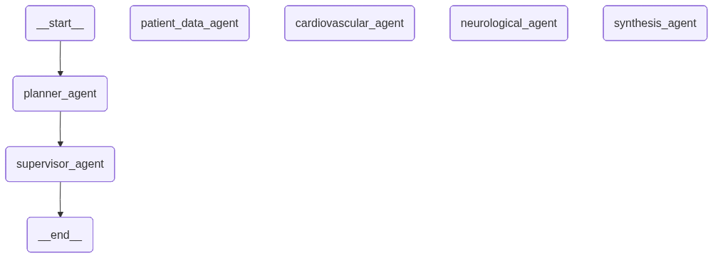

# DoctorAssistant

Doctor Assistant is a **Multi-Agent System (MAS)** built with **LangGraph/LangChain** that provides
AI-powered medical symptom analysis and preliminary diagnosis. It orchestrates multiple specialized agents working together to analyze patient symptoms, retrieve medical history, and generate
comprehensive medical assessments.

## Video Demo

[Watch the demo video](https://drive.google.com/file/d/1xdEF-TDnVvLbRdakQA4jO5fB_Z5fvROG/view?usp=sharing)

